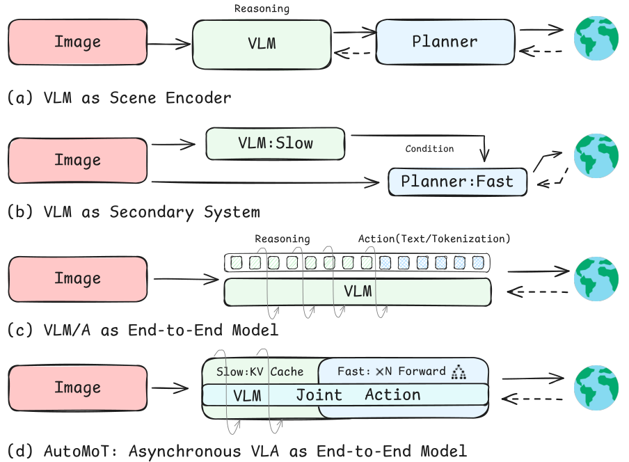
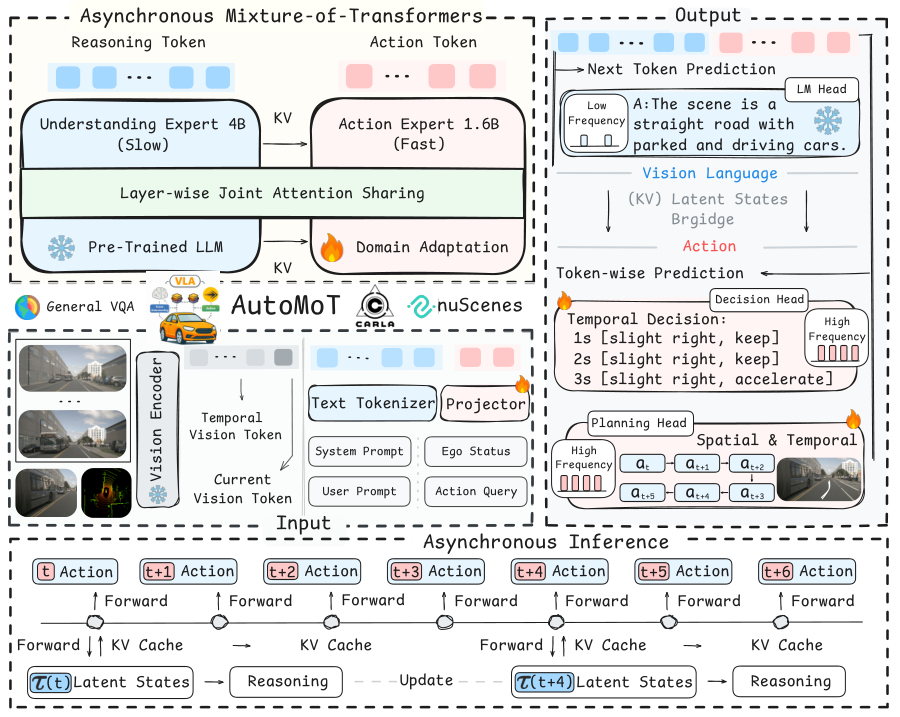
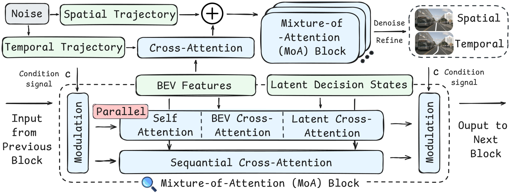
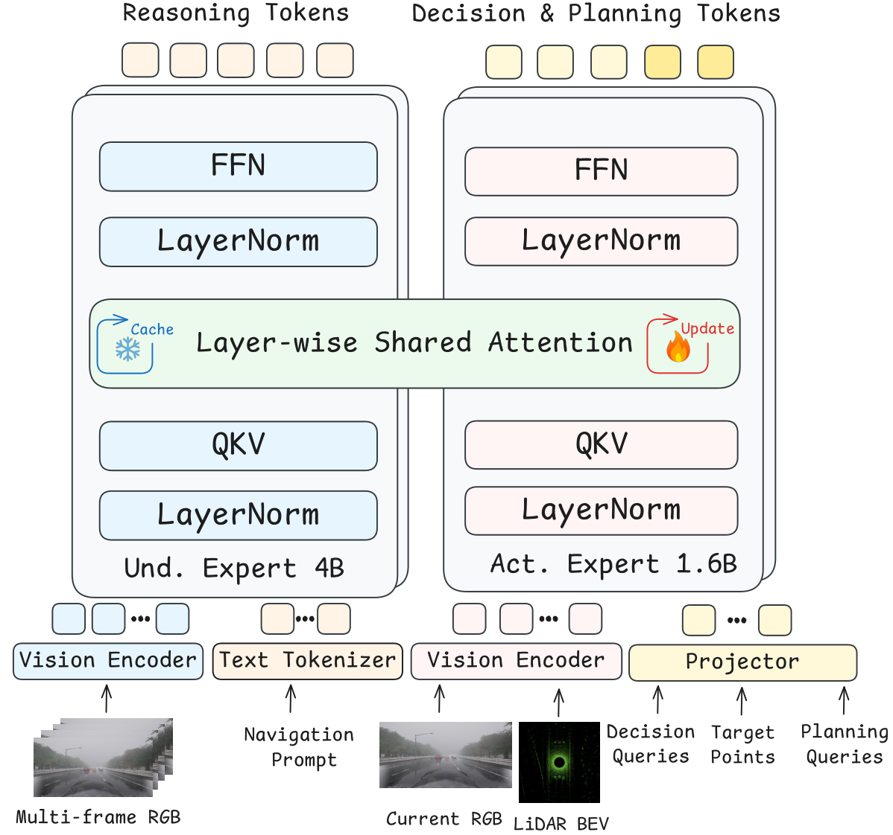

# AutoMoT 论文深度解读

> **论文标题**：*AutoMoT: A Unified Vision-Language-Action Model with Asynchronous Mixture-of-Transformers for End-to-End Autonomous Driving*
> **中文译名**：AutoMoT：面向端到端自动驾驶的统一视觉-语言-动作模型，采用异步 Transformer 混合架构
> **类型**：方法论文（提出新模型），ICML 投稿
> **作者**：Wenhui Huang、Songyan Zhang、Qihang Huang、Zhidong Wang、Zhiqi Mao、Collister Chua、Zhan Chen、Long Chen、Chen Lv
> **机构**：南洋理工大学（主要）、哈佛大学、小米汽车（Xiaomi EV）
> **版本**：arXiv:2603.14851v3 [cs.CV]，2026-03-16 v1，2026-05-14 v3
> **项目页**：https://automot-website.github.io/

---

## 一、核心问题与动机

### 1.1 研究背景

将 VLM（视觉-语言模型）集成进端到端自动驾驶（E2E-AD）已被证明能改善场景理解。但**现有集成策略存在三大局限**：

1. **推理空间与动作空间分布错位**——VLM 的语义推理结果难以直接对齐到精确的动作/轨迹输出；
2. **预训练 VLM 的通用推理能力未被充分利用**——要么被冻结而隔离开，要么被微调而丢失通用能力；
3. **动作策略生成时的推理延迟过大**——VLM 的逐 token 生成严重拖慢驾驶帧率，损害驾驶性能。

### 1.2 对比的四种范式（Figure 1）

> **图 1**：将 VLM 集成到端到端自动驾驶框架的不同范式对比。AutoMoT 通过层间联合注意力共享，在单一 VLA 模型内统一推理与动作策略学习，同时支持不同执行频率任务的异步推理。

| 范式 | 代表 | 问题 |
|------|------|------|
| (a) VLM 作为上游模块 | Orion、ReCogDrive | 推理-动作空间错位 |
| (b) 双系统架构（VLM 为辅助） | DriveVLM、Senna | 未充分利用 VLM |
| (c) 单骨干 VLA + 自回归 | AutoVLA、SimLingo、Alpamayo-R1 | 推理延迟大 |
| **(d) AutoMoT 的 MoT + 异步** | 本文 | （目标方案） |

---

## 二、AutoMoT 核心架构：Transformer 混合（MoT）

> **图 2**：作为端到端自动驾驶框架，AutoMoT 在单一 VLA 模型内统一场景理解、决策制定与轨迹规划。它采用 MoT 架构，通过层间联合注意力共享连接理解专家与动作专家，并借助 KV 缓存实现不同频率的异步推理。进一步探索了 VLA 导向的动作精炼器，通过基于扩散的精炼增强驾驶性能。

AutoMoT 在**单一 VLA 模型内统一三个功能**：场景理解（高层推理）、决策制定（元动作）、轨迹规划（时空路径点）。三个组件**全部基于 Transformer 架构**实现。

### 2.1 理解专家（Understanding Expert, UE）——冻结的"大脑"

**角色定位**：UE 的职责是**场景理解 + 生成思维链（CoT）推理**，重点处理长尾与罕见场景，同时**把通用知识迁移给下游动作策略学习**。

**骨干与输入**：
- 采用 **Qwen3-VL-4B 稠密模型**作为视觉-语言骨干；
- 输入为车载相机采集的**多视角、多帧 RGB 图像** $I^{RGB}\in\mathbb{R}^{N\times H\times W\times C}$，加上**文本提示** $\ell$（由系统提示 + 用户指令组成）；
- 输出语义推理结果。

**核心设计——全程冻结**：为了**充分保留预训练 Qwen3-VL 的通用知识、避免推理能力的灾难性退化**，UE 在整个训练过程中被完全冻结。这个"冻结 vs 微调"的权衡依据在第 4.3 节（功能边界探究）有专门实验论证（见本文第七节）。

> **设计直觉**：把 VLM 当作"只读的世界知识库 + 语义编码器"，而不是一个会被驾驶数据"洗掉"通用能力的可训练模块。UE 只负责"看懂 + 想明白"，不直接产出控制量。

### 2.2 动作专家（Action Expert, AE）——从零训练的"执行者"

**角色定位**：AE 在统一 VLA 框架内负责**决策制定 + 轨迹规划**，是真正产出驾驶动作的核心模块。

**输入**：每个时间步 $t$，AE 接收当前观测
$$o_t = \{I^{RGB}_t, I^{BEV}_t, Q(t)\}$$
其中 $I^{RGB}_t$ 是 RGB 相机图像，$I^{BEV}_t$ 是 **LiDAR BEV 特征**，$Q(t)$ 是**动作 query**。

**三个预测头（输出）**：AE 从这些输入产生动作侧潜在表示，再解码为三类输出，覆盖同一 3 秒 horizon：

| 输出 | 符号 | 含义 |
|------|------|------|
| 元动作（meta-actions） | $\hat{Z}_t = \{\hat{z}_{t+h}\}_{h=1}^{H}$，$H=3$ | 未来 3 秒的语义决策，1s 间隔 |
| 时间路径点（temporal waypoints） | $\hat{Y}_t = \{\hat{y}_{t+m}\}_{m=1}^{M}$，$M=6$ | 同一 horizon 内 0.5s 间隔采样 |
| 空间路线点（spatial route points） | $\bar{Y}_t = \{\bar{y}_{t+n}\}_{n=1}^{N}$ | 参数化参考路径的路线节点 |

> 简言之：**元动作 = "做什么"（语义层）**，**时间路径点 = "怎么动"（运动学层）**，**空间路线点 = "沿哪条路"（几何层）**。三层输出共享同一套潜在表示，保证决策与规划一致。

**注意力设计——混合因果/双向**（详见第三节 + 图 3）：
- **跨任务交互（语言、跨模态、跨任务）→ 因果注意力**：决策依赖理解、规划依赖"理解 + 决策"，形成层次因果；
- **任务内/自模态交互 → 双向注意力**：同一任务内的多模态特征可自由聚合。

**规模与训练**：AE 是一个**约 1.6B 参数的任务专用 Transformer**，**从零训练**以捕获自动驾驶的领域知识。

**运行频率**：AE 的运行频率**高于 UE**，这是实现高效推理、支持实时驾驶的关键（详见第四节异步机制）。

### 2.3 动作精炼器（Action Refiner, AR）——扩散"打磨"轨迹

**背景**：扩散策略（diffusion policy）近期在自动驾驶中展现出强潜力。AutoMoT 将策略模块实现为基于 **DiT（Diffusion Transformer）的扩散策略**。

**关键创新——截断扩散（truncated diffusion）**：
- 传统扩散从**白噪声**（Chi et al.）或**聚类轨迹**（Zou et al.）开始逆向去噪；
- AutoMoT 改用 **AE 预测的时空轨迹作为"信息先验"**，从这个先验出发做**截断的逆向去噪**，生成精炼后的轨迹。
- **好处**：更可靠的初始化 + 显著加速推理。

**噪声形式**：对 AE 轨迹提案施加**乘性高斯噪声**：
$$\tau' = (1+\epsilon_{\text{mul}}) \odot \tau$$
（乘性而非加性——因为轨迹提案本身就是"接近真值"的锚点，乘性噪声能在"扰动幅度正比于轨迹尺度"的意义上更合理地做局部扰动。）

**query 构建与条件注入**：
- 基于加噪轨迹，构造时间轨迹 query $Q_{temp}\in\mathbb{R}^{B\times M\times 2}$ 与空间 query $Q_{spatial}\in\mathbb{R}^{B\times N\times 2}$，拼接为 $X=[Q_{temp}\,\|\,Q_{spatial}]$；
- 经 $N$ 层 DiT 解码块处理；
- 条件信号 $c$ 融合了**扩散时间步 + 当前自车状态 + 低维状态历史**，通过 **AdaLN（自适应层归一化）**注入每一层。

**去噪时的两个互补信息源**：
1. AE 的**潜在决策状态 $h_{de}$** → 用于"决策感知"的轨迹生成；
2. 视觉编码器的 **BEV 特征 $F_{bev}$** → 用于空间引导。

### 2.4 Mixture-of-Attention（MoA）机制——AR 的核心融合模块

> **图 4**：基于 DiT 的动作精炼器架构，含 Mixture-of-Attention 模块。

**要解决的问题**：去噪时需要融合两类异质信息（决策状态 $h_{de}$ + BEV 特征 $F_{bev}$）。现有扩散规划器有两种做法，各有缺陷：

| 现有做法 | 代表 | 缺陷 |
|---------|------|------|
| 把异质模态**展平成单一 token 序列**做联合注意力 | Li et al. 2025c | 稀释了轨迹先验的结构性引导 |
| **顺序交叉注意力**依次处理各模态 | Liao et al. 2025 | 固定了注意力顺序，把"模态重要性"绑定到"处理顺序"上 |

**MoA 的解法——主-旁路融合（main-bypass fusion）设计**：

1. **主通路（main pathway）**：对三个来源**并行**计算注意力：
   - 时间/空间 query 之间的**自注意力**；
   - 对 BEV 特征的**交叉注意力**；
   - 对潜在决策状态的**交叉注意力**。
   - 其中，决策状态的贡献由一个**可学习因子 $g=\tanh(\gamma)$ 调制**，实现对多帧元动作的自适应控制。

2. **残差旁路（residual bypass）**：为了在扩散各阶段稳定信息传播，引入保留不同模态全局上下文线索的旁路：
   - $R_{bev}$：对 BEV 特征做**均值池化**；
   - $R_{reason}$：对推理 token 做**注意力池化**。

3. **最终融合**：
$$X' = X + \alpha \cdot \big(O_{\text{main}} + \sigma(\beta_b)\,R_{bev} + \sigma(\beta_r)\,R_{reason}\big)$$
   其中 $O_{main}$ 是主通路融合输出，$\alpha$ 是由 AdaLN 基于条件 $c$ 导出的缩放因子，$\sigma(\beta_b)$、$\sigma(\beta_r)$ 是**可学习的门控系数**。

> **核心价值**：MoA 让"语言/决策"与"视觉/BEV"两条信息流**并行、自适应地融合**，既不被展平稀释，也不被固定顺序绑架，同时**保留轨迹锚点先验**（$X$ 本身作为残差基底）。

---

## 三、统一推理与动作生成：层间联合注意力共享

> **图 3**：本文的注意力 mask 在统一注意力空间内协调理解、决策与规划。它支持任务内多模态聚合与跨任务信息流，同时保留任务级因果顺序。这种混合设计在保持层次因果性的同时支持丰富的上下文整合，使 AutoMoT 实现连贯的多任务推理、决策与轨迹规划。

这是 AutoMoT **最核心的技术创新**——通过"层间联合注意力共享"，让推理（UE）与动作（AE）在**同一个注意力空间内**深度融合，而非像传统方案那样把 VLM 当作独立的上游模块。

#### 3.1 逐层联合注意力的数学机制

在每一注意力层 $l$（$l=1,\dots,L$）：

1. **AE 生成逐层 QKV**：$\{Q^l_{act}(t), K^l_{act}(t), V^l_{act}(t)\}$

2. **UE 的 KV 被缓存复用**：设 $\tau(t)\le t$ 为"动作步 $t$ 时最近一次可用场景表示更新的时间索引"。在更新时刻 $\tau(t)$，UE 产出一组逐层 KV 表示，存入持久缓存：
$$\mathcal{C}^{\tau(t)} = \{K^l_{scene}(\tau(t)), V^l_{scene}(\tau(t))\}_{l=1}^{L}$$

3. **拼接 KV**：把 UE 在 $\tau(t)$ 时刻的缓存 KV 与 AE 在 $t$ 时刻的 KV 沿序列维度拼接（所有 K/V 共享同一嵌入维度 $d$）：
$$\tilde{K}^l(t) = [K^l_{scene}(\tau(t)) \;\|\; K^l_{act}(t)], \quad \tilde{V}^l(t) = [V^l_{scene}(\tau(t)) \;\|\; V^l_{act}(t)]$$

4. **联合注意力**：AE 的 query 同时 attend 到"场景语义（缓存）+ 动作自身"：
$$\text{Attn}^l(t) = \text{softmax}\left(\frac{Q^l_{act}(t)\,\tilde{K}^l(t)^\top}{\sqrt{d}}\right)\tilde{V}^l(t)$$

#### 3.2 这解决了什么问题

- **传统方案**（VLM 作为上游模块）的痛点是**推理空间与动作空间的分布错位**：VLM 产出的语义 token 无法直接对齐到轨迹/动作，中间需要额外的映射/对齐模块。
- **AutoMoT 的做法**是让 AE 的注意力**直接"看到"UE 的中间 KV 表示**，把高层场景理解**在潜在空间内"注入"动作生成过程**，从而：
  1. 让决策与规划**扎根于**高层场景理解；
  2. 实现从预训练 VLM 到策略学习的**知识迁移**；
  3. **无需**额外的语义→动作对齐模块，端到端可微。

#### 3.3 注意力 mask 的层次因果设计（图 3）

图 3 展示的 mask 严格规定了三类交互的因果关系：

| 交互类型 | 注意力类型 | 具体规则 |
|---------|-----------|---------|
| 跨任务（理解→决策→规划） | **因果注意力** | 决策表示**条件于**理解；规划进一步**条件于**"理解 + 决策" |
| 任务内 / 自模态 | **双向注意力** | 同一任务内、不同模态的 latent 特征自由聚合 |

> **为什么要分层因果**：保证"先看懂 → 再决策 → 后规划"的**时间/逻辑顺序不被破坏**（规划不能"偷看"未来的决策），同时又允许每个任务内部充分融合多模态信息。这正是 AutoMoT 能"连贯地"完成多任务推理、决策与轨迹规划的结构性原因。

---

## 四、异步推理（Fast-Slow 设计）

### 4.1 核心思想：多速率过程

异步推理的本质，是把"推理"和"动作推理"建模为**两个以不同时间分辨率演化的过程**，但两者**都扎根于实时视觉观测**。这两个过程的交互由**共享的 KV 缓存**中介（图 2）。

- **UE（理解专家）**：低频运行——只在需要"重新理解场景"时更新，产出的 KV 存入缓存；
- **AE（动作专家）**：高频运行——每个动作步都用当前观测 + 缓存里的场景 KV 做联合注意力。

这正是第三节公式（3）（4）（5）的落点：$\tau(t)\le t$ 允许 AE 复用"以更低频率更新的场景表示"，从而**让决策与轨迹规划以高于场景理解的执行频率运行，同时仍扎根于实时感知输入**。

> **一句话理解**：VLM 不用每帧都"重新思考"，AE 只要"复用上一次想明白的场景语义"即可快速出动作——这就是 fast-slow 双系统的落地方式。

### 4.2 延迟与频率的量化收益

| 配置 | 生成式规划器 | UE(ms) | AE(ms) | AR(ms) | 总(ms) | 频率(Hz) |
|------|:---:|:---:|:---:|:---:|:---:|:---:|
| AutoMoT-S（同步） | ✗ | 80.3 | 37.0 | — | 117.3 | 8.5 |
| **AutoMoT（异步）** | ✗ | **0.0** | 37.0 | — | **37.0** | **27.0** |
| AutoMoT-S（同步）+AR | ✓ | 80.3 | 37.0 | 26.0 | 143.3 | 7.0 |
| **AutoMoT（异步）+AR** | ✓ | **0.0** | 37.0 | 26.0 | **63.0** | **16.0** |

**关键结论**：
- 非生成模式下延迟降低 **68.5%**（117.3ms → 37.0ms）；
- 异步步骤中 **UE 延迟为 0**（80.3ms 被完全省去，直接复用 KV 缓存）；
- 频率从 8.5Hz 提升到 **27Hz**，满足实时驾驶要求。

### 4.3 异步的代价几乎可忽略

消融实验（Table 5、7）显示，异步相对同步仅带来 **0.62%** 的平均 L2 退化，决策准确率也仅边际下降（联合准确率 53.49% → 53.10%）——说明 **KV 缓存复用很好地保留了语义与时间一致性**。

---

## 五、训练方法与损失函数

### 5.1 决策训练（数据集：NuSync，自建，80.1K 样本）

**问题形式化**：决策被建模为**元动作上的 token 级序列建模问题**，条件于多帧驾驶观测。

**NuSync 的构造**（基于 nuScenes 构建）：
- 输入 = **4 帧连续历史 RGB** + 一个额外的 **RGB-BEV 对**；
- **同步样本**：RGB-BEV 对与最后一帧历史同时间戳：
$$I^{sync}_t = \{I^{RGB}_t, I^{RGB}_{t+1}, I^{RGB}_{t+2}, I^{RGB}_{t+3}, I^{RGB}_{t+3}, I^{BEV}_{t+3}\}$$
- **异步样本**：4 帧历史保持连续，RGB-BEV 对构造在 **1 帧和 2 帧未来偏移**（对应 2Hz 下的 0.5s 和 1s）：
$$I^{async}_t = \{I^{RGB}_t, I^{RGB}_{t+1}, I^{RGB}_{t+2}, I^{RGB}_{t+3}, I^{RGB}_{t+k}, I^{BEV}_{t+k}\},\quad k\in\{4,5\}$$

- **输出**：3 秒 horizon 的元动作，在 1s、2s、3s 处标注，最多 **20 种"纵向 × 横向"组合**（纵向：加速/减速/保持/停车 × 横向：左转/微左/直行/微右/右转）。
- 清洗后 NuSync 共 **80.1K 样本**，是**首个支持异步多帧元动作推理的开源决策数据集**。
- 对 CARLA 仿真，用同样协议基于 PDM-Lite 构建 **PDM-Meta**（因仿真中横向边界模糊，仅标注纵向决策）。

**损失函数（token 级预测，区别于 UE 的 next-token）**：AE 预测元动作 token 序列 $\hat{z}_t=\{\hat{z}_t^j\}_{j=1}^{J}$，通过最小化目标决策 token 的负对数似然优化：
$$\mathcal{L}_{\mathrm{DM}}=\mathbb{E}_{(o_t,z_t)\sim\mathcal{D}}\left[-\sum_{j=1}^{J}\log p_\theta(z_t^j\mid o_t)\right] \tag{1}$$

> **为什么用 token-wise 而非 next-token**：元动作是"当前观测直接对应的一组语义决策"，不存在"逐 token 自回归生成"的必要；token 级并行预测更高效、更贴合决策任务本身。

### 5.2 轨迹规划训练

遵循 nuScenes 原始设置：用 4 帧历史预测 3 秒未来轨迹。按 PDM-Lite，3 秒轨迹表示为**时间路径点（捕捉运动动态）+ 20 个空间路线点（捕捉道路几何）**。

AE 用 $\ell_1$ 损失优化轨迹规划（与决策联合优化）：

- 时间轨迹：
$$\mathcal{L}_{\text{traj}}^{\text{temp}}=\mathbb{E}_{(o_t,Y_t^{\text{temp}})\sim\mathcal{D}}\left[\frac{1}{M}\sum_{m=1}^{M}\|\hat{Y}_{t+m}-Y_{t+m}^{\text{temp}}\|_1\right] \tag{2}$$
- 空间轨迹：
$$\mathcal{L}_{\text{traj}}^{\text{spatial}}=\mathbb{E}_{(o_t,Y_t^{\text{spatial}})\sim\mathcal{D}}\left[\frac{1}{N}\sum_{n=1}^{N}\|\bar{Y}_{t+n}-Y_{t+n}^{\text{spatial}}\|_1\right]$$

其中 $Y_t^{\text{temp}}$、$Y_t^{\text{spatial}}$ 是真值时间/空间轨迹。

> **关键**：决策与轨迹规划在 AE 内**联合优化**，使 AutoMoT 学到"扎根于 UE 语义表示"的**连贯动作策略**。

### 5.3 动作精炼器训练（截断扩散）

- 数据集：**PDM-Lite**（70 万+样本，5000+场景），每样本 4 帧历史 @2Hz，任务是精炼 AE 提出的时空路径点。
- **范式**：**截断扩散**——把 AE 的提案轨迹当作"锚点"，从这一信息先验出发逆向去噪到专家真值（而非从高斯噪声开始）。
- **损失**：L1 重构误差。

### 5.4 训练基础设施

8× NVIDIA A100，**FSDP（Fully Sharded Data Parallel）** 并行，学习率 $1\times10^{-4}\to2\times10^{-5}$。

---

## 六、实验结果

### 6.1 闭环规划（Bench2Drive）

| 方法 | 专家VLM | 生成式规划器 | DS↑ | SR(%)↑ |
|------|:---:|:---:|:---:|:---:|
| DriveTransformer-Large | — | — | 63.46 | 35.01 |
| DiffusionDrive | — | ✓ | 77.68 | 57.72 |
| TransFuser++ | — | — | 84.21 | 67.27 |
| ORION | ✓ | ✓ | 77.74 | 54.62 |
| AutoVLA | ✓ | — | 78.84 | 57.73 |
| SimLingo | ✓ | — | 85.07 | 67.27 |
| **AutoMoT** | ✓ | — | **87.34** | **70.00** |
| **AutoMoT+** | ✓ | ✓ | **89.42** | **74.09** |

**关键发现**：AutoMoT 在 DS 和 SR 上均超越所有 VLM 增强基线；超越 SimLingo（后者还用了动作 dreamer 数据增强）；加 AR（AutoMoT+）进一步提升。

### 6.2 开环规划（nuScenes）

| 方法 | L2avg↓ | Coll avg↓ |
|------|:---:|:---:|
| DriveTransformer-Large | 0.33 | 0.07 |
| AutoVLA | 0.40 | 0.20 |
| SpaceDrive | 0.32 | 0.23 |
| Drive-R1 | 0.31 | 0.09 |
| **AutoMoT** | **0.32** | **0.07** |

**关键发现**：AutoMoT 取得 **SOTA 碰撞率（0.07）**，与 DriveTransformer-Large 并列；L2 位移 0.32 有竞争力。仅 OpenEMMA 和 AutoMoT 不微调 VLM 骨干，而 AutoMoT 大幅超越 OpenEMMA（L2 0.32 vs 2.81）。

### 6.3 推理能力对比

| 方法 | LingoQA | OmniDrive | CODA-LM | TallyQA | InfoVQA |
|------|:---:|:---:|:---:|:---:|:---:|
| ReCogDrive | 67.20 | 0.82 | 5.90 | 69.60 | 75.80 |
| OpenEMMA | 48.00 | 0.43 | 4.80 | 80.00 | 71.40 |
| **AutoMoT** | **67.00** | **0.89** | **6.07** | **81.40** | **89.30** |

**关键发现**：AutoMoT（冻结 VLM）在 AD 基准上与微调基线持平，在通用基准（TallyQA、InfoVQA）上显著领先。

### 6.4 推理延迟（数量级优势）

| 方法 | 延迟(ms) | 频率(Hz) |
|------|:---:|:---:|
| OpenEMMA | 7683 | 0.13 |
| AutoVLA（慢） | 10518 | 0.10 |
| SimLingo | 430 | 2.3 |
| AutoMoT-S（同步） | 117 | 8.5 |
| **AutoMoT（异步）** | **37** | **27** |

---

## 七、预训练 VLM 功能边界的核心发现

受控消融（冻结 vs 微调）：

| 基准 | 任务类别 | AutoMoT†（冻结） | AutoMoT‡（微调） |
|------|---------|:---:|:---:|
| LingoQA | 场景理解 | 67.00 | 67.20 |
| OmniDrive | 反事实规划 | 18.20 | **67.80** |
| ScienceQA | 通用知识 | 88.60 | 87.80 |
| FigureQA | 通用知识 | 97.60 | 91.20 |
| TallyQA | 通用知识 | **81.40** | 52.40 |
| InfographicVQA | 通用知识 | **89.30** | 50.20 |
| VizWiz | 通用知识 | **75.60** | 50.20 |

**四个关键结论**：

1. **场景理解靠语义提示即可**：冻结的预训练 VLM 仅靠语义提示就能达到有竞争力的多任务场景理解（微调 LingoQA 仅 67.00→67.20 边际提升）。

2. **动作级任务必须微调**：反事实规划（OmniDrive）微调后 18.20→67.80 巨大提升，确认动作级任务需领域适配。

3. **灾难性遗忘是任务依赖的**：简单答案空间轻微退化；复杂组合推理严重退化（~50% 相对降幅）。

4. **功能边界结论**：高层场景理解不需大量领域适配；任务级微调应**只针对动作级组件**。

---

## 八、消融研究

### 8.1 异步 vs 同步推理（规划质量）
| 配置 | L2avg↓ |
|------|:---:|
| AutoMoT-S（同步） | 0.322 |
| AutoMoT（异步） | 0.324 |

仅 **0.62%** 相对退化——时间解耦几乎无损失。

### 8.2 理解专家的作用（预训练 vs 随机初始化）
| 配置 | L2avg↓ |
|------|:---:|
| 预训练 UE | 0.32 |
| 随机 UE | 0.36 |

预训练 UE 贡献显著，长 horizon 退化更明显。

### 8.3 决策目标的作用
| 配置 | L2avg↓ |
|------|:---:|
| 完整（决策+规划联合） | 0.32 |
| 仅规划 | 0.34 |

联合训练改善性能，尤其长 horizon。

---

## 九、主要贡献与结论

### 9.1 四大贡献
1. **AutoMoT 框架**：通过层间联合注意力共享实现统一的异步 VLA 模型
2. **功能边界探究**：澄清 AD 专属微调的必要性与程度
3. **VLA 导向的动作精炼器**：基于扩散的轨迹精炼提升驾驶性能
4. **广泛评估**：在多样基准上达到 SOTA 竞争力

### 9.2 核心结论
1. AutoMoT 在闭环（Bench2Drive）和开环（nuScenes）基准上达 SOTA，同时保持 VLM 骨干冻结。
2. 预训练 VLM 已通过语义提示提供强多任务场景理解。
3. 微调对动作级任务必要，但会导致高层推理的灾难性遗忘。
4. 异步推理 + KV 缓存带来 68.5% 延迟降低，仅 0.62% 规划精度退化。
5. MoT 架构在保留通用推理能力的同时，通过联合注意力共享实现高效的领域动作学习。

### 9.3 局限
- **车载部署**：VLA 规模模型对当前车载算力仍资源密集；
- **扩散随机性**：闭环驾驶中可能放大轨迹偏差累积；
- **通用 VQA 在微调下退化**：体现领域专精与通用推理保留的根本权衡。

---

## 十、与你研究脉络的关联

这篇论文是 VLA / 语言-动作落地方向的具体方法实现，回应了"语言-action grounding 开放挑战"。

**与目录强相关**：
- **[[DiffusionDriveV2_论文分析|DiffusionDrive]]** → AutoMoT 的动作精炼器（AR）同为扩散轨迹生成
- **[[AutoVLA]]、[[OpenDriveVLA]]** → AutoMoT 正是这些方法的对标与超越对象
- **[[Planning-Oriented_E2E-AD_综述_深度解读_含位置索引|Planning-Oriented E2E-AD 综述]]** → 本文是其 VLA 章节的具体落地
- **Flow Matching 类** → 与 AR 的扩散精炼形成"扩散 vs 流匹配"对照

---

## 参考链接

- 论文摘要：https://arxiv.org/abs/2603.14851
- 论文 HTML：https://arxiv.org/html/2603.14851v3
- 论文 PDF：https://arxiv.org/pdf/2603.14851
- 项目页：https://automot-website.github.io/
